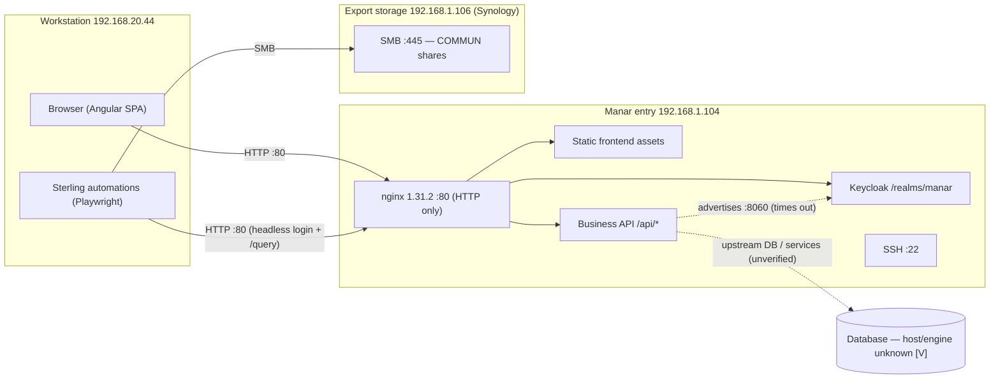
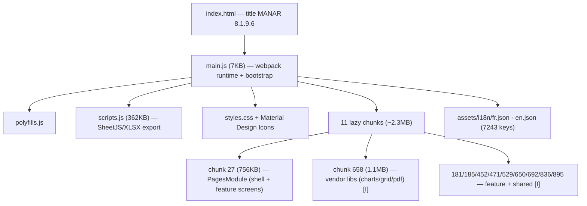
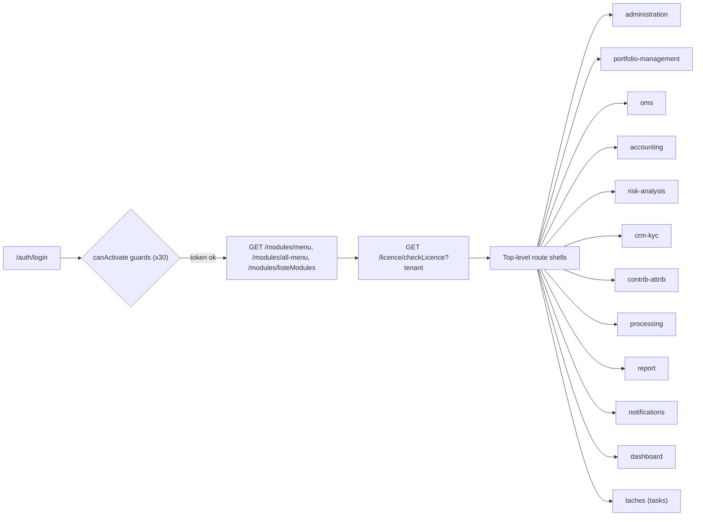
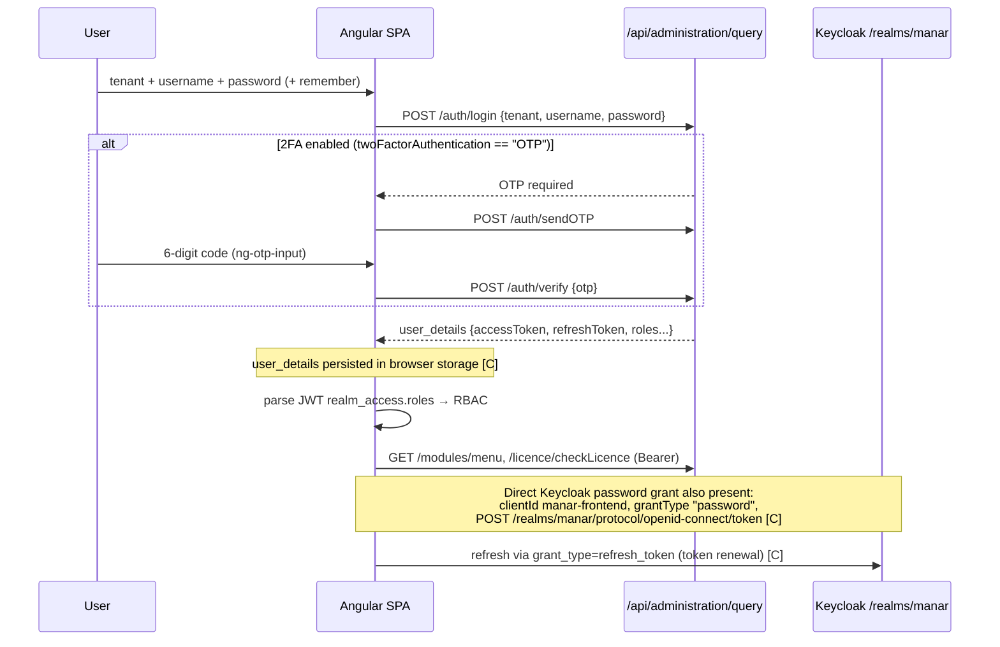
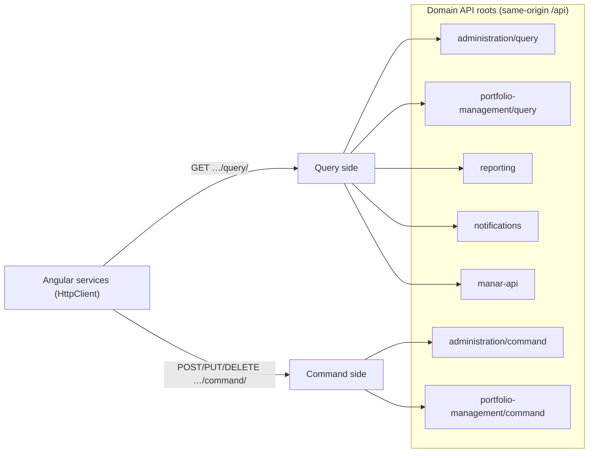
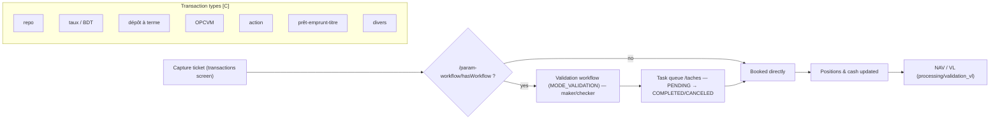

# Manar — architecture of how it works
### Evidence-based reverse-engineering, v0.1 · 2026-10-20

> **Purpose.** A detailed, diagram-led map of how the Manar platform (Perenity, v**8.1.9.6**,
> deployment string `8.1.9.6.0`) is built and behaves, as a foundation for a clean-room
> reimplementation and for targeted REA work later.
>
> **Method & provenance.** Derived **read-only** and **without logging in**, from: (a) the
> infrastructure/security review; (b) Sterling's own automation code (the API contract it already
> calls); (c) **static analysis of the served frontend** — `index.html`, the webpack runtime, 11
> lazy chunks (~2.9 MB JS), the i18n dictionaries (7,243 strings), and app config — fetched
> same-origin in the browser pane. No Manar source is copied here; this describes **interfaces and
> behaviour** only. Every claim is tagged **[C]** confirmed from the bundle/review, **[I]** inferred,
> or **[V]** to verify in the authenticated walk-through.

---

## 1. System context



- **Frontend, API and identity are same-origin behind nginx** on `192.168.1.104:80`, HTTP only. **[C]**
- Keycloak discovery advertises `192.168.1.104:8060` as issuer, but `:8060` is not directly
  reachable from the workstation — a reverse-proxy/issuer-alias setup. **[C]**
- The **database and application host topology are not observable** from the client and remain
  unverified. **[C/V]**
- Export storage is a separate **Synology NAS** (SMB shares) used for file drops, not a proven DB
  backup. **[C]**

## 2. Frontend architecture



- **Angular 14.2.11** SPA (declared in webpack bootstrap), **hash routing** (`/#/auth/login`). **[C]**
- Built with Angular CLI/webpack; **module-federation-style lazy chunks** (`loadChildren`×35). **[C]**
- **Client-side Excel export** via **SheetJS** bundled in `scripts.js` (explains the OOXML schema
  strings); **PDF/chart** libs in the large vendor chunk. **[C]** → the "DL_EXCEL / DL_PDF" toolbar.
- **Dashboards are draggable widget grids** (angular-gridster2 signatures: `notPlaced`,
  `autoPositionItem`), persisted per user (`/widgets/*`, `/favoris/*`). **[C]**
- **i18n** FR/EN, FR primary; 7,243 label keys = the de-facto feature catalogue. **[C]**
- **Bilingual, tenant-aware, theme-configurable** (`/parametrage-theme/get-theme`). **[C]**

## 3. Routing & navigation model — *server-driven*

The single most important architectural trait: **Manar's menu and routes are configured on the
server, not hard-coded in the SPA.**



- Static top-level routes only: `auth, login, reset-password, dashboard, administration,
  portfolio-management, oms, accounting, risk-analysis, crm-kyc, contrib-attrib, processing, report,
  notifications, taches, blank-page, 404`. **[C]**
- The actual sub-screens per module are **driven by `/modules/menu` + entitlements** returned at
  runtime; sub-routes are **not** statically declared in the bundle. **[C → confirms dynamic menu]**
- **Entitlement/licence gating**: the module list is filtered by licence + user profile; the
  `MODULE` catalogue is: `CRM, ADMINISTRATION, UI, MODE_VALIDATION, NOTIFICATION, RISQUE,
  PORTFOLIO_MS, OMS, PORTFOLIO_MANAGEMENT, ACCOUNTING, TOOLS, PORTFOLIO_PROCESSING, PROCESSING,
  TABLEAU_BOARD`. **[C]**

**Known concrete screen routes** (from static strings; the full list is server-driven **[V]**):

| Area | Route | Purpose |
|---|---|---|
| Portfolio | `/portfolio-management/portfolio/transactions/repo` | Repo booking **[C]** |
| Portfolio | `…/transactions/taux` | Rate/bond (BDT) transactions **[C]** |
| Portfolio | `…/transactions/dat` | Dépôt à terme (term deposit) **[C]** |
| Portfolio | `…/transactions/opc` | OPCVM/fund transactions **[C]** |
| Portfolio | `…/transactions/action` | Equity transactions **[C]** |
| Portfolio | `…/transactions/pret-emprunt-titre` | Securities lending/borrowing **[C]** |
| Portfolio | `…/transactions/divers` | Miscellaneous **[C]** |
| Portfolio | `/portfolio-management/portfolio/echeancier` | Coupon/maturity schedules **[C]** |
| OMS | `/oms/ordres/ordre-bourse` | Stock-exchange order ticket **[C]** |
| Processing | `/processing/portefeuilles/validation_vl` | NAV (VL) validation **[C]** |
| CRM/KYC | `/crm-kyc/prospects-management/prospect-control-validation/{PP\|PM}` | Prospect onboarding validation **[C]** |
| Admin | `/administration/referentiel/comptes-titres` | Securities-accounts reference data **[C]** |

## 4. Authentication & identity flow



- **Two coexisting auth paths**: (1) an **application login** `POST …/administration/query/auth/login`
  with a **`tenant`** parameter; (2) a **direct Keycloak Resource-Owner-Password grant**
  (`clientId: manar-frontend`, `grantType: "password"`). **[C]**
- **Optional OTP/2FA** (`sendOTP` / `verify`, `twoFactorAuthentication === "OTP"`, 6-box input). **[C]**
- Tokens live in a **`user_details`** object in **browser storage**; **roles come from the JWT**
  `realm_access.roles`; refresh via `refresh_token` grant. **[C]**
- **Multi-tenant** by design (tenant on login and licence checks). **[C]**
- *Security note (from review):* HTTP transport, password grant, and localStorage token persistence
  are the weaknesses — see the security review; Fanar's answers are in the Fanar spec `03`.

## 5. API architecture — message-style CQRS



- **CQRS split**: reads under `…/query/…`, writes under `…/command/…`, per domain. **[C]**
- **Domain roots observed**: `administration`, `portfolio-management` (each query+command),
  plus `reporting`, `notifications`, `manar-api`. CRM/KYC, OMS, accounting, risk, contrib-attrib,
  processing operations are reached **through these roots** (esp. `administration` and
  `portfolio-management`) and/or `manar-api`; they are **not** separate `/api/<domain>` roots in the
  client. **[C/I]**
- **Resource is in the path, operation largely by HTTP verb** (GET 371, DELETE 59, PUT 41, POST 13
  across the bundle → query-heavy UI). **[C]**
- Sterling's automation confirms deeper query paths, e.g. `portfolio-management/query/repo/list`,
  `portfolio-management/query/workspace/position-espece`, and writes to
  `portfolio-management/command/repo`. **[C, from own code]**

**Endpoint inventory (static, representative — not exhaustive):**

| Group | Endpoints (resource paths) |
|---|---|
| Auth | `administration/query/auth/login`, `/auth/sendOTP`, `/auth/verify`; Keycloak `/realms/manar/protocol/openid-connect/token` |
| Menu/entitlement | `/modules/menu`, `/modules/all-menu`, `/modules/listeModules`, `/licence/checkLicence` |
| Workflow | `/param-workflow/hasWorkflow`, `/param-workflow/active-type-transactions`, `/param-workflow/typeTransactions` |
| Jobs (batch) | `/jobs`, `/jobs/loadJobById`, `/jobs/{id}`, `reportingApi/jobs/{id}` |
| Config/params | `/parametrages/findOne`, `/list/getParamApplicationByCode`, `/parametrage-theme/get-theme`, `/users/get-parametrage` |
| Portfolio (own-code) | `portfolio-management/query/repo/list`, `…/query/workspace/position-espece`, `…/command/repo`, `/echeancier-taux/echeancier` |
| Dashboards | `/dashboard/{activites-crm, operations-douteuses, reclamations, top-depassements, top-depassements-sensibilite, top-performances, top-positions-cash, top-soldes-sr}` |
| Notifications/alerts | `/alerts/list`, `/alerts/read-lot`, `/alerts/read/{id}`, `/notification/{countUnread, findAll, setRead, setReadAll}`, push `subscribe/unsubscribe` |
| Tasks | `/tache/find` |
| Users | `/users/find`, `/users/get-parametrage` |
| Widgets/favoris | `/widgets/{get-all, user-widget, report, delete}`, `/favoris/{getAll, save, delete}` |

## 6. Business module & screen map (from i18n + routes)

```mermaid
flowchart TB
  MANAR["MANAR 8.1.9.6"]
  MANAR --> CRM["CRM / KYC"]
  MANAR --> PM["Portfolio Management"]
  MANAR --> OMS["OMS"]
  MANAR --> PROC["Processing"]
  MANAR --> CA["Contribution & Attribution"]
  MANAR --> RISK["Risk Management"]
  MANAR --> ACC["Accounting"]
  MANAR --> ADM["Administration"]
  MANAR --> DASH["Dashboards / Home"]
  MANAR --> TASK["Tasks / Workflow"]
  MANAR --> NOTIF["Notifications / Alerts"]
  CRM --> CRM1["Prospects, Clients (PP/PM), Contacts"]
  CRM --> CRM2["Onboarding, GED documents, Comptes espèce"]
  CRM --> CRM3["Positions, Operations, Watchlists, Incidents"]
  PM --> PM1["OPCVM: VL details, portefeuille valorisé, opérations en cours"]
  PM --> PM2["Transactions: repo, taux, dat, opc, action, prêt-emprunt-titre, divers"]
  PM --> PM3["Échéanciers, position consultation (sous-rachat / moyenne)"]
  OMS --> OMS1["Carnet d'ordre, ordre-bourse"]
  OMS --> OMS2["Order validation rules (ISIN, quantité, position espèce/titre, sens)"]
  CA --> CA1["Performance portefeuilles, ratio performance"]
  CA --> CA2["Attribution par dimension, contribution (pbs/%), index management"]
  RISK --> R1["Board review, risk analytics, market data"]
  RISK --> R2["Ratios AMMC, dépassements (limit breaches), journal logs"]
  ADM --> A1["Users (Keycloak/Web), profiles, licence"]
  ADM --> A2["Référentiel (comptes-titres), tables, audit, workflow, mode validation"]
  TASK --> T1["Types: ACT, COMPTE_TITRES, TAUX, OPC, DAT, REPOS, DIVERS, validation prospect"]
  TASK --> T2["States: PENDING / CANCELED / COMPLETED"]
  DASH --> D1["Widgets: tâches, jobs, réclamations, activités CRM"]
  DASH --> D2["Opérations douteuses (AML), positions cash, soldes SR, performances"]
```



## 7. Transaction & workflow model



- Manar has a **per-transaction-type workflow engine** (`param-workflow`) and a **validation mode**
  (`MODE_VALIDATION` module) — i.e. a native **maker-checker** gate, surfaced as **tasks**
  (`/taches`, states PENDING/CANCELED/COMPLETED) by type (REPOS, TAUX, DAT, OPC, …). **[C]**
- A **batch jobs engine** (`/jobs`) runs processing (valuations, generation) with status tracking
  (`STATUT_JOB_FAILED` in error catalogue). **[C]**
- **Order validation rules** are explicit (error catalogue): invalid ISIN, quantity below minimum /
  above maximum, position espèce/titre exceeded, invalid sens, order already exploited, platform
  limit exceeded. **[C]** → a pre-trade validation layer.

## 8. Inferred domain model (entities)

From routes, i18n and own-code (to be confirmed against live payloads **[V]**):

- **Tenant** (multi-tenant root), **User/Profile/Role** (Keycloak + Web users), **Licence/Module
  entitlements**.
- **Compte** (account: PP personne physique / PM personne morale), **Contact**, **Prospect**,
  **GED document**, **Compte espèce** (cash account).
- **OPCVM/Fund (FCP)** with **VL/NAV** and valuation; **Portefeuille** (valorised positions),
  **Position** (titres + espèces; "sous rachat" / "moyenne" variants).
- **Instrument** (BDT/action/OPC/CD…), **Échéancier** (schedule), **Taux/courbe** (rates/curves),
  **Market data**.
- **Transaction/Ordre** by type (repo, taux, dat, opc, action, prêt-emprunt, divers) with a
  **workflow state** and **task**.
- **Alert/Notification**, **Incident/Réclamation**, **Opération douteuse** (AML), **Ratio AMMC**
  (regulatory), **Dépassement** (limit breach), **Job** (batch), **Widget/Favori** (user UI state),
  **Audit** entry.

## 9. Confirmed / inferred / to-verify summary

| Topic | Status | Note |
|---|---|---|
| nginx HTTP-only same-origin FE+API+IdP | **[C]** | review + bundle |
| Angular 14.2.11, hash routing, lazy chunks | **[C]** | bundle |
| Server-driven menu + licence entitlement | **[C]** | `/modules/*`, `/licence/*` |
| CQRS query/command per domain | **[C]** | bundle + own code |
| Keycloak password grant + app login + OTP + tenant | **[C]** | bundle |
| Tokens in browser `user_details`; roles from JWT | **[C]** | bundle + review |
| Per-type workflow (maker-checker) + tasks | **[C]** | `/param-workflow`, `/taches` |
| Batch jobs engine | **[C]** | `/jobs` |
| Full sub-screen inventory per module | **[V]** | server-driven → capture after login |
| Exact query/command operation names & payloads | **[V]** | capture live `/query` `/command` bodies |
| DB engine / app host / container topology | **[V]** | not client-observable |
| Pricing/valuation internals | **[V]** | server-side; infer from outputs |

## 10. What this means for the rebuild (design pointers)

1. **Adopt the good bones, drop the weaknesses.** Keep the **CQRS split**, **server-driven menu +
   entitlements**, **per-type workflow/maker-checker**, **tasks**, **batch jobs**, **config-driven
   params**, **persisted user dashboards**. Replace HTTP→HTTPS, password-grant→auth-code+PKCE+MFA,
   localStorage tokens→BFF session, EOL Angular→supported stack.
2. **Model operations as explicit commands/queries with names + payloads**, versioned — Manar's
   two-fat-endpoints style is workable but opaque; make the contract explicit and documented.
3. **Treat the transaction-type taxonomy as a first-class domain** (repo/taux/dat/opc/action/
   prêt-emprunt/divers) with a configurable workflow per type — this is exactly Sterling's treasury
   pain point and Manar's maker-checker already proves the shape.
4. **Regulatory (AMMC ratios), AML (opérations douteuses) and limit-breach dashboards are core**,
   not add-ons.
5. The **full screen inventory is only knowable at runtime** — plan the authenticated REA capture
   (next doc) to enumerate it precisely.
```
