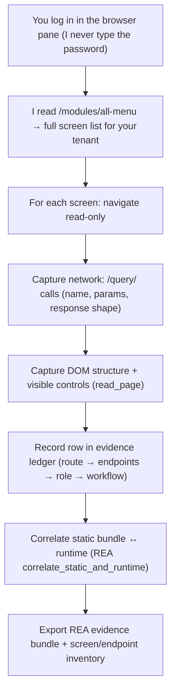

# Manar — REA plan & beneficial decisions
### How to use REA at its best for this target · 2026-10-20

This complements `01-manar-architecture.md`. It records the decisions that make reverse-engineering
Manar efficient and defensible, and the concrete workflow for the **authenticated** capture (the
part that needs you logged in).

---

## 1. What REA is — and isn't — for here

Manar is a **server-driven web app**. That shapes the tool choice:

- **Most architecture is static** and already captured by reading the served bundle (routes,
  chunks, auth config, API roots, i18n). No heavy engine needed for that. **Done.**
- **The complete screen inventory and the exact query/command payloads are runtime facts** — they
  only appear once you log in and the server returns your tenant's menu. This is where REA's
  **browser runtime observation** earns its keep: drive the authenticated SPA read-only and
  **capture the network + DOM per screen** into a reusable **evidence bundle**.
- REA is **not** needed to "decompile Perenity's server" — we can't see it from the client, and we
  don't want their source. We map **behaviour and the interface contract**, which is what a
  clean-room rebuild and the strangler anti-corruption layer actually need.

## 2. Beneficial decisions to lock in now

1. **Pin a version baseline.** Record the exact asset fingerprints of **8.1.9.6.0** so a future
   Manar upgrade can be diffed (new/removed endpoints, changed screens) with REA's
   `compare_bundles` / `compare_application_versions`. Current chunk hashes:
   `main .be7e378…`, `27 .193e85ee…`, `658 .26a092c0…`, `650 .e4979b6c…`, `452 .0778a4bf…`,
   `181 .e43aaee5…`, `185 .9bdf8802…`, `471 .90f09998…`, `529 .37b74060…`, `692 .c40b901e…`,
   `836 .9574c58e…`, `895 .3c84bb58…`, `polyfills .e2d33357…`, `scripts .e68a9507…`,
   `styles .9d2a0c49…`. Keep a dated copy of the JS/i18n for the record (vendor assets — store
   privately, do not redistribute).
2. **Capture read-only, never write.** The whole exercise stays on `…/query/…` and navigation.
   **Never** trigger `…/command/…`, Enregistrer/Valider, or a booking — mirror Sterling's existing
   read-only guard (block `POST/PUT/PATCH/DELETE` except login). This is both your standing rule and
   the safe-RE rule.
3. **Use one tenant, a low-privilege read account** for capture if possible, so the menu/entitlement
   surface is representative without exposing admin-only write flows.
4. **Keep an evidence ledger.** For each screen: route, the `/query/` calls it fires (name + params
   + response *shape*, not the business data), required role/entitlement, and the workflow type if
   any. One row per screen → this becomes the clean-room functional spec and the ACL contract.
5. **Record shapes, not secrets or data.** Save JSON **schemas/field names**, not customer records,
   tokens, or portfolio values. No credentials in any artefact.
6. **Separate observed from inferred** in every note (the `[C]/[I]/[V]` tags), and never imply
   static analysis saw execution.

## 3. Authenticated capture workflow (needs your login)

**Step by step:**
1. **You** sign in (tenant + user + OTP). Tell me when the dashboard is showing. Consider clicking
   **"Always allow"** for `192.168.1.104` so the per-site prompts stop.
2. I fetch **`/modules/all-menu`** (and `listeModules`) to enumerate every screen your profile can
   see — the authoritative "all the windows" list.
3. I walk each route **read-only**, using REA browser observation (`capture_browser_scenario` /
   `observe_web_session`) and the pane's `read_page` + `read_network_requests`, capturing the
   `/query/` operation names, parameters, and **response field shapes**.
4. I build the **screen → endpoint → role → workflow** inventory and the **query/command catalogue**
   (the contract the Fanar anti-corruption layer must speak).
5. I run **`correlate_static_and_runtime`** to tie runtime calls back to the static modules, and
   **`export_evidence_bundle`** so the analysis is reusable and diffable against future versions.

## 4. Deliverables from the authenticated pass

- `03-screen-inventory.md` — every window, its route, its data calls, its entitlement/role.
- `04-api-contract.md` — the query/command catalogue with request/response **shapes** (the ACL spec).
- `05-domain-model.md` — entities confirmed from live payloads (upgrade the inferred model in `01`).
- A stored **REA evidence bundle** + the versioned asset baseline for future diffs.

## 5. Guardrails (unchanged)

- Read-only; no writes, no bookings, no `/command/`.
- Interface/behaviour only; **no Perenity source reproduced** into Fanar.
- Shapes and field names, **never** customer data, tokens, or secrets.
- Confirm Manar licence terms permit interoperability analysis before extensive capture (the legal
  checkpoint in the Fanar spec `00` §3).

> **Status:** static pass complete (`01`). Authenticated pass is **ready to run the moment you're
> logged in** — it's the only way to enumerate the server-driven screens and exact payloads.
